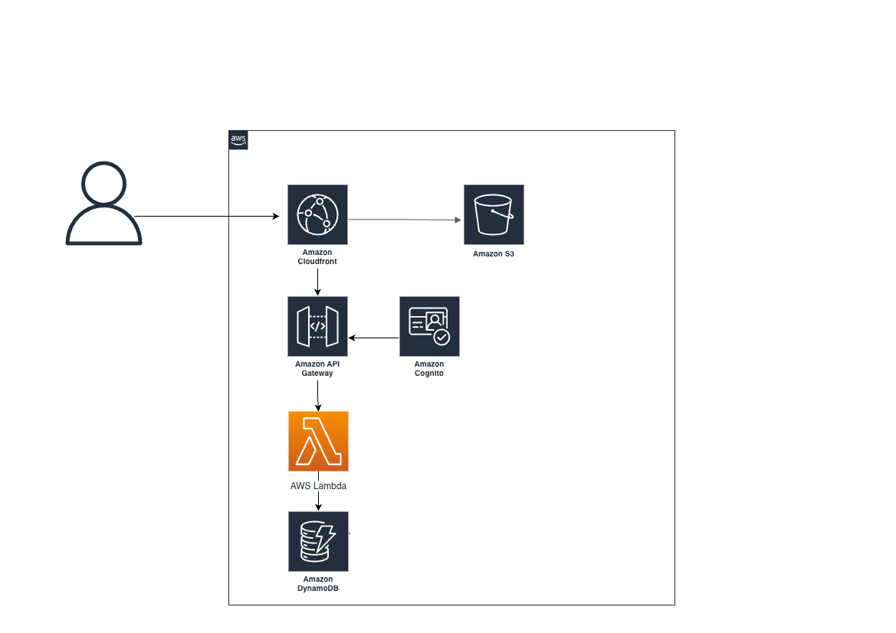
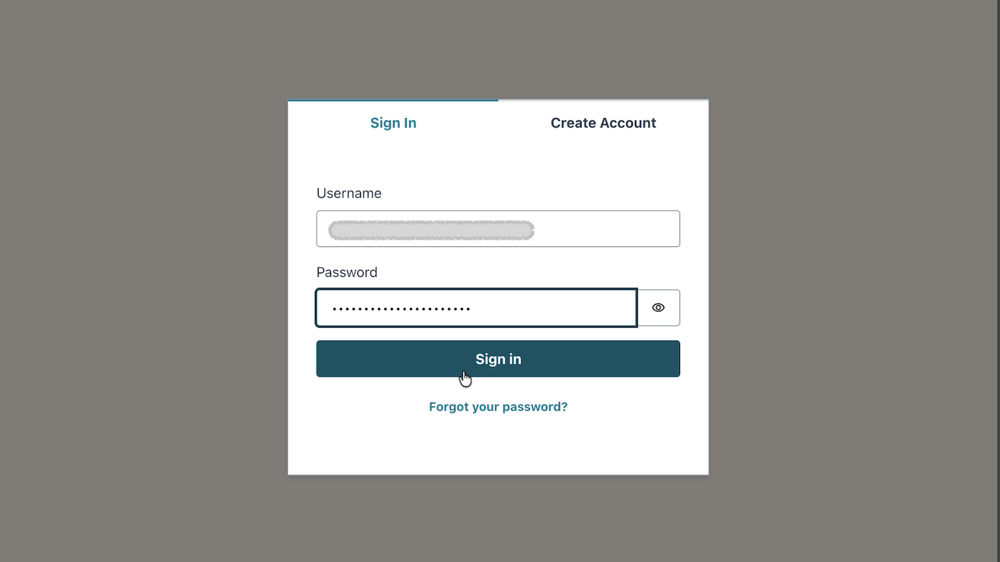
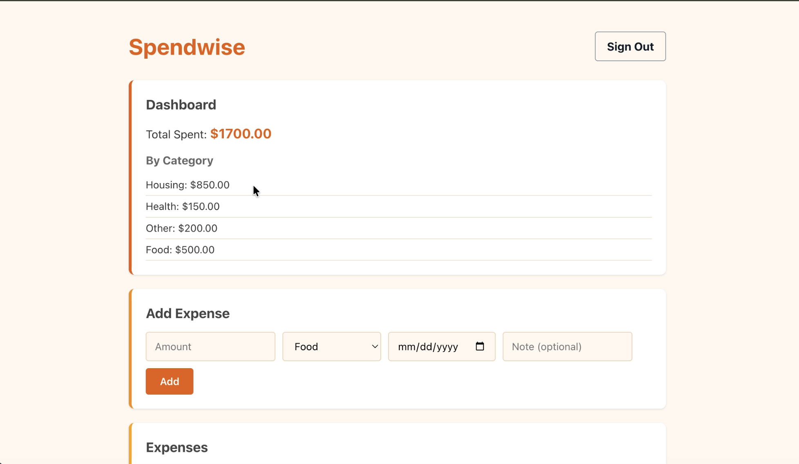
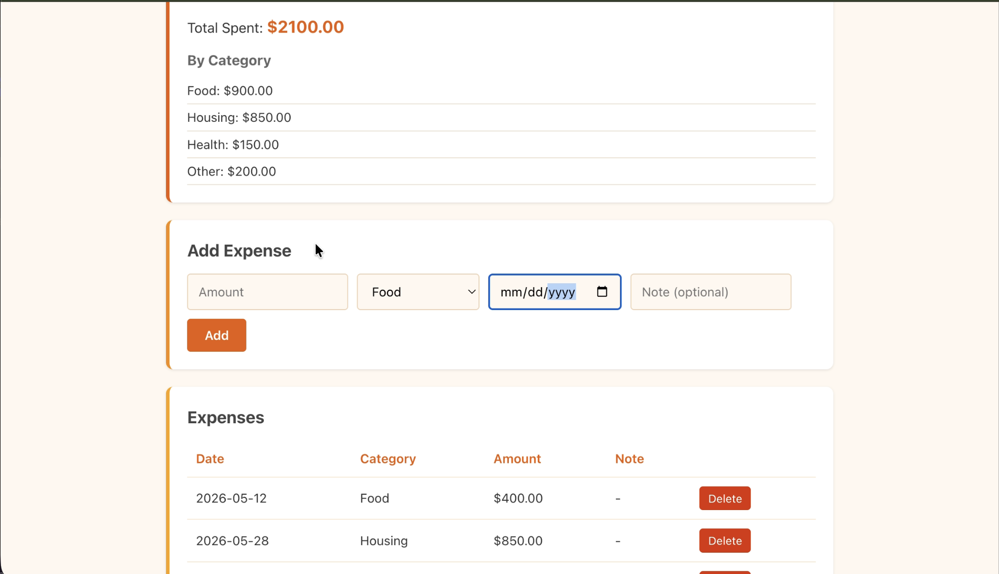
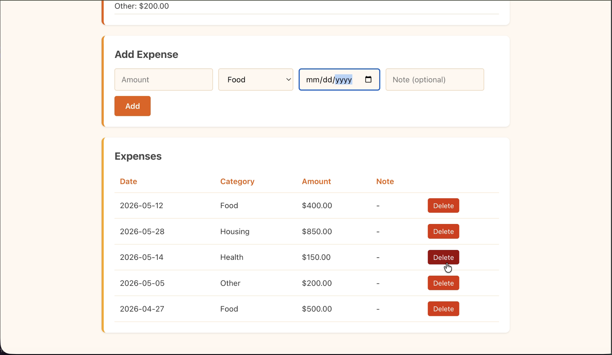

# Spendwise

A serverless personal budget tracker built on AWS.

## Why This Project
I wanted to build something real. Not follow a tutorial, not complete a lab with predefined steps actually sit down with a blank repo and figure it out.

Serverless was the area I wanted to understand deeply. I had studied the individual services but had never connected them together into something that actually worked. I wanted to know what happens when a request leaves a browser and travels through CloudFront, gets checked by Cognito, hits API Gateway, triggers a Lambda function, and lands in DynamoDB. The only way to really understand that is to build it.

A budget tracker was the right scope small enough to finish, real enough to matter. I made every decision myself: which services to use, how to structure the backend, how to handle auth, how to define infrastructure as code. When things broke and they did. I had to figure out why.

## Stack
- **Frontend**: React → S3 + CloudFront
- **Backend**: Python Lambda + API Gateway
- **Database**: DynamoDB
- **Auth**: Cognito
- **Infrastructure**: AWS SAM
- **CI/CD**: GitHub Actions

## Architecture


## Features
- Add expenses by category, date, and amount
- Dashboard with total spent and category breakdown
- Delete expenses
- Secure login via Cognito

## Screenshots
## Screenshots





## What I Learned
- **AWS SAM**: defines the entire backend Lambda functions, DynamoDB table, API Gateway routes, and IAM roles.
- **CORS errors**: are browser security enforcement, not frontend bugs. The fix always lives on the API side.
- **DynamoDB**: returns numeric values as strings in some SDK versions. Always cast with `parseFloat()` before doing math.
- **Cognito app clients**: for browser-based apps must be public with no client secret client secrets are for server-side apps only.
- **GitHub Actions**: secrets keep AWS credentials out of code while still enabling automated deployments.


## Project Status & Future Improvements

### Status
I built and deployed Spendwise on AWS. The backend (Lambda, API Gateway, and DynamoDB) is defined with SAM and was deployed through GitHub Actions. I configured Cognito, S3, and CloudFront manually in the AWS console, outside SAM. After development I decommissioned the AWS environment to avoid ongoing costs. The SAM template and pipeline are still in the repo, so the backend can be redeployed with `sam deploy`. The deploy workflow now only runs when triggered manually.

### Planned Improvements
1. **Gate deploys on CI.** I want the deploy job to depend on CI passing, using `needs:` or `workflow_run`. Right now the two workflows run independently, so failing code could reach production.
2. **Use GitHub OIDC instead of access keys.** I plan to replace the long-lived AWS access keys with OIDC and an IAM role scoped to this repo and the `main` branch. Nothing permanent would be stored in GitHub, and the credentials could only be used from this repo.
3. **Skip deploys for docs-only commits.** A `paths:` filter would stop README and screenshot changes from triggering a deploy.
4. **Prevent overlapping deploys.** A `concurrency:` group would make sure two quick pushes can't deploy at the same time.
5. **Define the whole stack as code.** I want to bring Cognito, S3, and CloudFront into the SAM template, so the full environment can be recreated from the repo instead of partly by hand.

## Getting Started

Clone the repo and install frontend dependencies:

```bash
git clone https://github.com/s-dad/SpendWise.git
cd SpendWise/frontend
npm install
npm start
```

To deploy the full backend you will need your own AWS account:

```bash
cd infrastructure/spendwise-backend
sam build
sam deploy --guided
```

Update `src/api.js` with your API Gateway URL from the CloudFormation Outputs, and create a Cognito user pool following the setup in the [docs](docs/) folder.


## License
MIT


